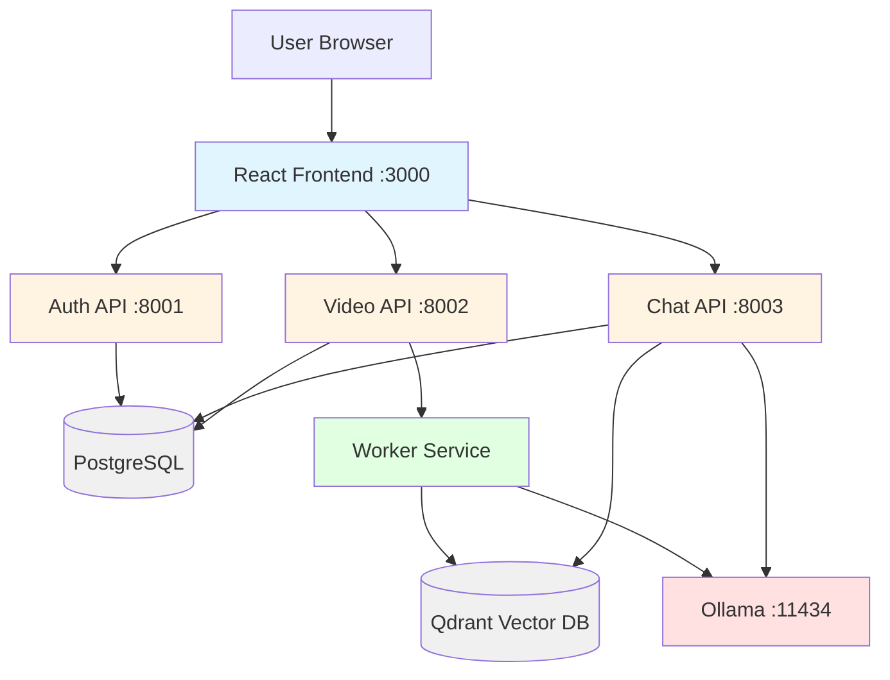
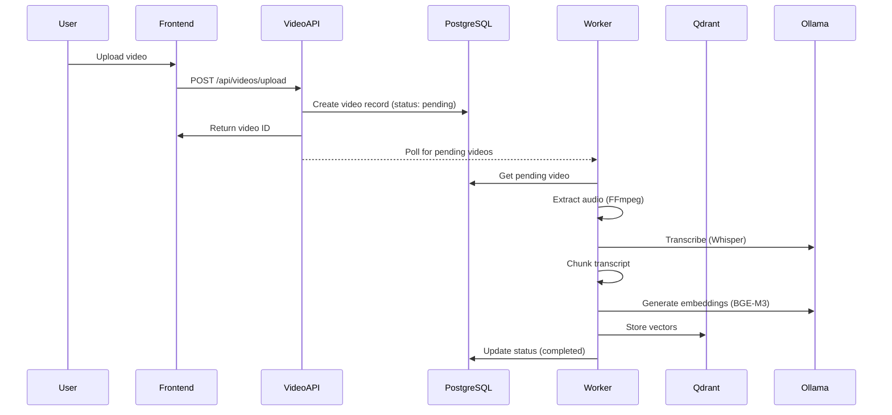
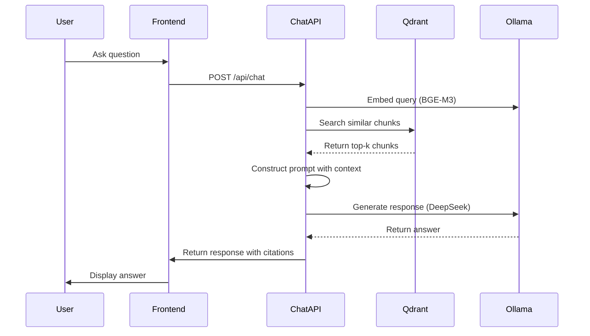

# Vidyatrix Architecture

## System Overview

Vidyatrix is a microservices-based AI SaaS platform for video learning assistance.

## Architecture Diagram

## Data Flow

### Video Upload Flow

### Chat Flow

## Service Responsibilities

### Auth API
- User registration and authentication
- JWT token generation and validation
- User profile management
- Token-based authorization

### Video API
- Video upload handling
- File validation (type, size)
- Video metadata storage
- Video listing and deletion
- User data isolation

### Chat API
- Chat message handling
- Query embedding
- Vector similarity search
- LLM response generation
- Citation formatting
- Conversation management

### Worker Service
- Polls for pending videos
- Audio extraction (FFmpeg)
- Speech-to-text (Whisper)
- Transcript chunking
- Embedding generation
- Vector storage
- Status updates

### Frontend
- User interface
- Authentication flow
- Video upload UI
- Chat interface
- Citation display

## Technology Choices

### Backend Framework: FastAPI
- Fast and modern
- Automatic API documentation
- Type hints support
- Async support

### Database: PostgreSQL
- Reliable and mature
- ACID compliance
- JSON support
- Excellent tooling

### Vector Database: Qdrant
- Fast vector search
- Easy to use
- Docker support
- HNSW indexing

### AI Models
- **Whisper**: Speech-to-text (OpenAI)
- **BGE-M3**: Embeddings (via Ollama)
- **DeepSeek-R1**: LLM (via Ollama)

### Frontend: React + TypeScript
- Component-based
- Type safety
- Large ecosystem
- TanStack Query for data fetching

## Data Models

### User
- id (UUID)
- email (unique)
- hashed_password
- name
- created_at

### Video
- id (UUID)
- user_id (FK)
- title
- filename
- file_path
- duration
- status (enum)
- error_message
- created_at

### TranscriptChunk
- id (UUID)
- video_id (FK)
- start_time
- end_time
- text
- created_at

### Conversation
- id (UUID)
- user_id (FK)
- title
- created_at

### ChatMessage
- id (UUID)
- conversation_id (FK)
- role (enum)
- content
- sources (JSON)
- created_at

## Security

### Authentication
- JWT access tokens
- Password hashing (bcrypt)
- Token expiration (24 hours)

### Authorization
- User-level data isolation
- Token validation on all endpoints
- Role-based access (future)

### Data Protection
- SQL injection prevention (SQLAlchemy)
- File upload validation
- CORS configuration
- Environment variable management

## Scalability Considerations

### Current MVP Limitations
- Simple polling for background jobs
- No caching layer
- Single database instance
- Local file storage

### Future Improvements
- Redis for caching and job queue
- RabbitMQ for message queuing
- Database read replicas
- S3/Cloud storage
- CDN for static assets
- Load balancing
